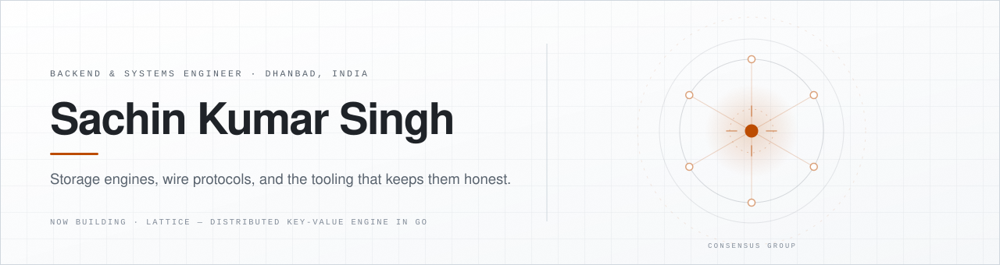
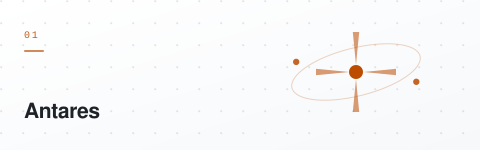
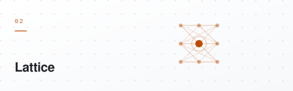
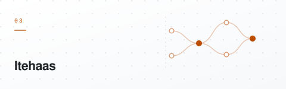
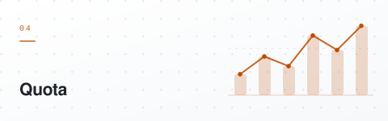
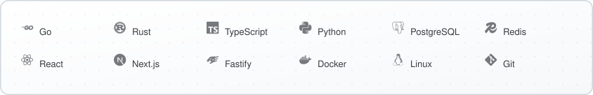

<div align="center">
  <picture>
    <source media="(prefers-color-scheme: dark)" srcset="assets/hero-dark.svg">
    <source media="(prefers-color-scheme: light)" srcset="assets/hero-light.svg">
    
  </picture>
</div>

<div align="center">
  <picture>
    <source media="(prefers-color-scheme: dark)" srcset="assets/social-dark.svg">
    <source media="(prefers-color-scheme: light)" srcset="assets/social-light.svg">
    
  </picture>
</div>

<p align="center">
  Most of my work lives below the framework — wire protocols, storage formats, consensus, and the test suites that keep them honest.
</p>

## Selected work

<table>
  <tr>
    <td width="50%" valign="top">
      <a href="https://github.com/silent-knight19/Antares">
        <picture>
          <source media="(prefers-color-scheme: dark)" srcset="assets/antares-dark.svg">
          <source media="(prefers-color-scheme: light)" srcset="assets/antares-light.svg">
          
        </picture>
      </a>
      <p>A Redis-compatible server written from scratch in Go. RESP2, 71 commands, framed AOF persistence, LRU eviction, transactions, and replication with full and partial resync.</p>
      <p>Verified by a differential harness against pinned Redis 7.4.11, selected official Tcl suites, fuzzing, and 100&times; SIGKILL crash tests.</p>
      <p><code>Go</code> <code>RESP2</code> <code>AOF</code> <code>Replication</code></p>
    </td>
    <td width="50%" valign="top">
      <a href="https://github.com/silent-knight19/Lattice">
        <picture>
          <source media="(prefers-color-scheme: dark)" srcset="assets/lattice-dark.svg">
          <source media="(prefers-color-scheme: light)" srcset="assets/lattice-light.svg">
          
        </picture>
      </a>
      <p>A distributed key-value storage engine built from core primitives in Go. LSM-tree storage, CRC32 write-ahead log, skip-list memtable, Bloom-filtered SSTables, leveled compaction, and Raft consensus with linearizable reads.</p>
      <p>Transport is TLS 1.3 with mutual TLS and certificate-bound RBAC. All 22 architecture phases are implemented and verified.</p>
      <p><code>Go</code> <code>LSM-tree</code> <code>Raft</code> <code>mTLS</code> &middot; <a href="https://lattice-dydy.onrender.com">Live demo</a></p>
    </td>
  </tr>
  <tr>
    <td width="50%" valign="top">
      <a href="https://github.com/silent-knight19/Itehaas">
        <picture>
          <source media="(prefers-color-scheme: dark)" srcset="assets/itehaas-dark.svg">
          <source media="(prefers-color-scheme: light)" srcset="assets/itehaas-light.svg">
          
        </picture>
      </a>
      <p>A Git-inspired version control system and GitHub-like platform. A Rust CLI handles content-addressable storage, branching, three-way merge, rebase, and bisect, backed by a Fastify and PostgreSQL API and a Next.js web client.</p>
      <p><code>Rust</code> <code>TypeScript</code> <code>PostgreSQL</code> <code>Next.js</code> &middot; <a href="https://itehaas-web.vercel.app">Live demo</a></p>
    </td>
    <td width="50%" valign="top">
      <a href="https://github.com/silent-knight19/Quota">
        <picture>
          <source media="(prefers-color-scheme: dark)" srcset="assets/quota-dark.svg">
          <source media="(prefers-color-scheme: light)" srcset="assets/quota-light.svg">
          
        </picture>
      </a>
      <p>An extension for VS Code and Google Antigravity that tracks AI token usage and cost. Parses local logs into a SQLite ledger and renders session, workspace, and lifetime spend.</p>
      <p>Entirely offline, with no prompt or source-code retention and a locked-down content security policy.</p>
      <p><code>TypeScript</code> <code>Python</code> <code>SQLite</code> <code>VS Code API</code></p>
    </td>
  </tr>
</table>

## Byte level

Every mutating operation in Lattice is persisted to the write-ahead log and acknowledged only after the frame is durable. The header is fixed-width and big-endian, so a decoder can validate framing without allocating.

```
 0                   1                   2                   3
 0 1 2 3 4 5 6 7 8 9 0 1 2 3 4 5 6 7 8 9 0 1 2 3 4 5 6 7 8 9 0 1
+-+-+-+-+-+-+-+-+-+-+-+-+-+-+-+-+-+-+-+-+-+-+-+-+-+-+-+-+-+-+-+-+
|                      CRC32-IEEE Checksum                      |  Offset 0..3
+-+-+-+-+-+-+-+-+-+-+-+-+-+-+-+-+-+-+-+-+-+-+-+-+-+-+-+-+-+-+-+-+
|  RecordType   |                                               |  Offset 4
+-+-+-+-+-+-+-+-+                                               +
|                     Sequence Number (SeqNum)                  |  Offset 5..12
+                               +-+-+-+-+-+-+-+-+-+-+-+-+-+-+-+-+
|                               |                               |
+-+-+-+-+-+-+-+-+-+-+-+-+-+-+-+-+                               +
|                     Timestamp (Unix Nanos)                    |  Offset 13..20
+-+-+-+-+-+-+-+-+-+-+-+-+-+-+-+-+-+-+-+-+-+-+-+-+-+-+-+-+-+-+-+-+
|                               |          KeyLength            |  Offset 21..22
+-+-+-+-+-+-+-+-+-+-+-+-+-+-+-+-+-+-+-+-+-+-+-+-+-+-+-+-+-+-+-+-+
|                          KeyBytes...                          |  Offset 23...
+-+-+-+-+-+-+-+-+-+-+-+-+-+-+-+-+-+-+-+-+-+-+-+-+-+-+-+-+-+-+-+-+
|                         ValueLength                           |  Offset 23+KeyLen
+-+-+-+-+-+-+-+-+-+-+-+-+-+-+-+-+-+-+-+-+-+-+-+-+-+-+-+-+-+-+-+-+
|                         ValueBytes...                         |  Offset 27+KeyLen
+-+-+-+-+-+-+-+-+-+-+-+-+-+-+-+-+-+-+-+-+-+-+-+-+-+-+-+-+-+-+-+-+
```

## Stack

<div align="center">
  <picture>
    <source media="(prefers-color-scheme: dark)" srcset="assets/stack-dark.svg">
    <source media="(prefers-color-scheme: light)" srcset="assets/stack-light.svg">
    
  </picture>
</div>

<p align="center"><sub>AWS &#183; GitHub Actions &#183; Tailwind CSS &#183; Node.js &#183; SQLite &#183; Java &#183; Redis Cluster &#183; mTLS</sub></p>

---

<p align="center">
  <strong>Open to software engineering roles and internships.</strong><br/>
  <a href="https://github.com/silent-knight19">github.com/silent-knight19</a> &middot;
  <a href="https://www.linkedin.com/in/sachinsinghdev/">linkedin.com/in/sachinsinghdev</a> &middot;
  <a href="https://x.com/_Sachin_Singh19">@_Sachin_Singh19</a>
</p>
